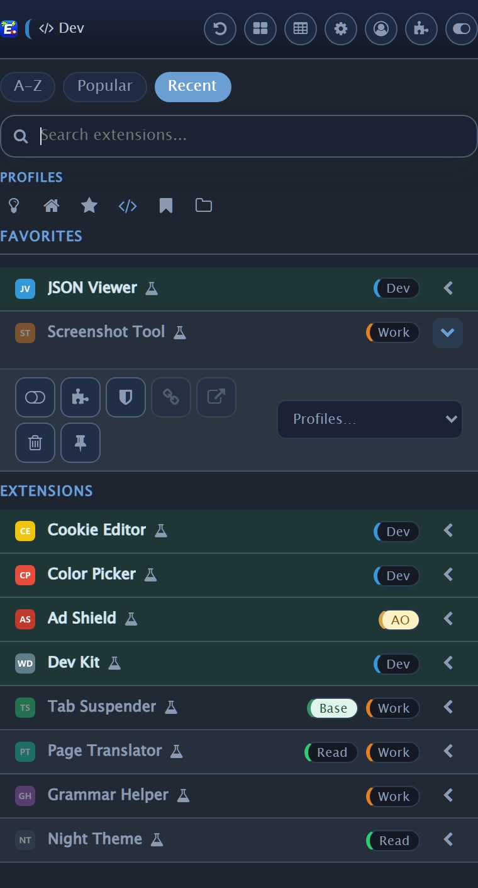
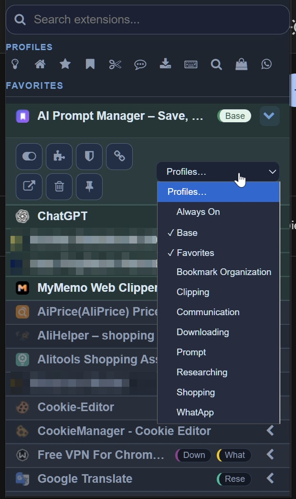
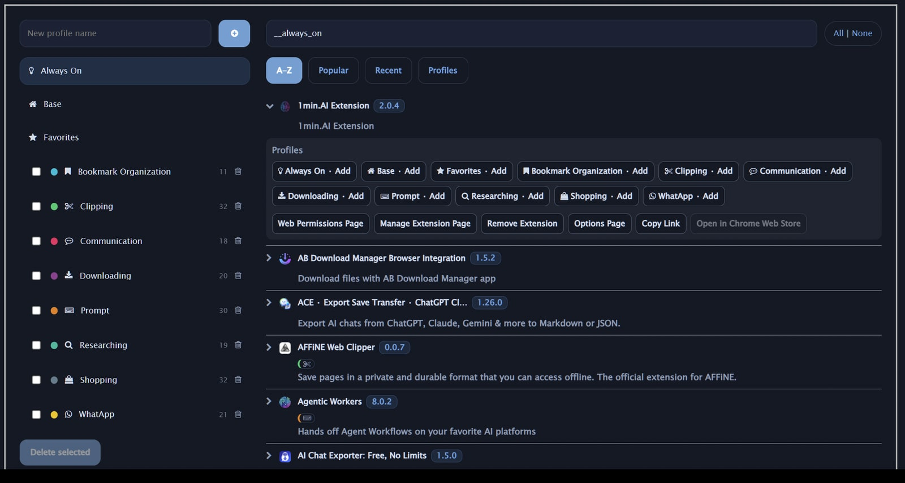
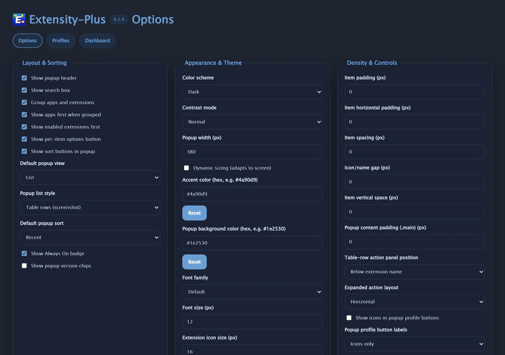

# Extensity-Plus

<p align="center">
  
</p>

Extensity-Plus is a Manifest V3 extension manager for Chrome and Chromium-based browsers such as Brave. It keeps the original [Extensity](https://github.com/sergiokas/Extensity) idea, one click to turn extensions on or off, and adds what you need for daily use:

- a popup for fast toggling, search and sorting
- reusable profiles, plus the special layers `Always On`, `Base` and `Favorites`
- URL rules that enable or disable extensions as you browse
- a dashboard for aliases, groups, rules, history, logs and backups
- settings sync through browser sync, with optional Google Drive sync

## Releases

Full notes for every version are on the [GitHub Releases page](https://github.com/Daniel-OS01/Extensity-Plus/releases).

**Latest: v4.7.4** (2026-11-21)
- Faster popup search and bulk toggle/profile apply. Accessibility fixes: the profile delete button names its profile, and inputs that only had a placeholder now have labels.

**Version 4** (2026-04 →)
- Google Drive sync, added in 4.2. It became safer in 4.7: each push, pull or conflict resolution is shown for confirmation first, a safeguard pauses changes that would delete too much, and *Undo last sync* restores the last backup. 4.x also added the Full / Smart / Minimal browser-sync modes, the dashboard Log tab, and quick URL-rule creation from the popup.

**Version 3** (2026-04)
- A Dashboard **Sync Status** tab for checking browser sync, and scoped JSON exports (only profiles, or only settings). Also a separate Favorites section in the popup and a steadier popup load.

**Version 2** (2026-04)
- The Extensity 2.0 rewrite: a Manifest V3 service worker that owns every enable/disable change, plus the dashboard (aliases, groups, URL rules, history). It also added undo, list/grid views, sorting by name, recent use or frequency, and pin-to-toolbar.

## Screenshots

**Popup: quick actions.** Toggle, search, sort, see profile badges and use per-extension actions inline.



**Popup: profile dropdown.** Edit profile membership, including the special profiles, without leaving the popup.



**Profiles page.** Build named extension sets and manage the special profiles alongside your own.



**Options page.** Popup layout, density, default sorting, appearance and behavior.



**Dashboard: URL rules.** Rules with a live tester, next to history, groups, aliases and import/export.


## Features

### Popup

- Enable or disable any extension in one click.
- Turn every extension off, then restore the previous set, in one action. `Always On` extensions can be kept on.
- Undo the last toggle, bulk action or profile change.
- Search by name, alias or description. Queries of 3+ characters also match typos (fuzzy matching).
- Sort alphabetically, by most recently used, or by how often each one is used.
- Switch between list and grid views.
- Add an extension to a profile, or remove it, from its expanded row.
- Pin an extension to the browser toolbar. *Automatic* mode clicks Chrome's own pin control for you and falls back to opening the extension's page. *Manual* mode always opens the page. Choose the mode in Options.

### Profiles

- Save reusable extension sets and apply them from the popup.
- Special layers: `Always On` (stays enabled whichever profile you apply), `Base` and `Favorites`.
- Rename profiles inline, set each one's color and icon, and bulk-delete selected profiles.
- Choose the layout of the Profiles page.
- Keyboard shortcuts: `Ctrl+Shift+E` turns all extensions off or back on. The shortcuts for the next and previous profile have no default key; assign them at `chrome://extensions/shortcuts`.

### URL rules

- Enable or disable chosen extensions when the active tab's URL matches a pattern.
- Patterns are either wildcards (`*://github.com/*`) or regular expressions.
- Test URLs against your rules in the dashboard before relying on them.
- Rules are evaluated in the background service worker.

### Dashboard

- Aliases (custom display names) and groups for installed extensions.
- History of extension events, with usage counters.
- Export your installed extensions as a CSV list.
- Import and export JSON backups, either full or scoped (see [Backup files](#backup-files)).
- **Log** tab: session log with selectable level (none / error / warn / info / debug), an *Errors only* filter, and copy to clipboard.
- **Sync Status**: browser-sync health check and Google Drive sync controls, including a read-only Drive connection test.

### Reminders

- Optional notification reminding you to turn an extension back off after you enable it manually.

## Install from source

The repository root is a loadable extension, and nothing needs to be built first.

1. Clone the repository.
2. Open `chrome://extensions` (or `brave://extensions`) and turn on **Developer mode**.
3. Click **Load unpacked** and select the repository root, or `dist/` after running `make dist` for the minified build.

The packaged `dist.zip` and the Chrome Web Store upload bundle are produced by the [release workflow](#ci-and-releases).

## Permissions

| Permission | Why it is needed |
|------------|------------------|
| `management` | List, enable and disable extensions. This is the core feature. |
| `storage` | Settings, profiles, rules, history and backups. |
| `tabs`, `webNavigation` | Evaluate URL rules against the active tab; open the dashboard, options and extension pages. |
| `alarms`, `notifications` | Reminder notifications and scheduled Drive sync. |
| `identity` | Google sign-in for the optional Drive sync. |
| `debugger` | Only for **automatic** pin-to-toolbar: briefly attaches to the `chrome://extensions` details page to click Chrome's own pin control. It never attaches to websites. |
| `https://www.googleapis.com/*` | Drive REST API calls, limited to the `drive.appdata` scope. |
| `https://chromewebstore.google.com/*` (optional) | Store metadata and links. The browser asks before granting it. |

Full rationale and Chrome Web Store wording: [`docs/chrome-web-store-privacy.md`](docs/chrome-web-store-privacy.md).

## Sync and backup

### Browser sync

Settings and profiles are stored in `chrome.storage.sync`, which the browser syncs across signed-in devices. That storage is capped at about **100 KB** in total and **8 KB** per key. Options → **Browser Sync** offers three modes:

| Mode | What syncs | Best for |
|------|------------|----------|
| **Full** | All options + full profile memberships | Small profile sets; maximum portability |
| **Smart** (default) | All options + `Always On`, `Base`, `Favorites` + profile metadata; large custom profiles stay local | Most users; avoids per-key quota failures |
| **Minimal** | Options + profile metadata only; memberships stay on each device | Lowest sync footprint |

If profiles outgrow the quota, the extension falls back to **local-only profiles** (`localProfiles`), and the dashboard shows that it has done so. Dismissed banners are stored locally to save quota.

**Checking sync health.** Dashboard **Sync Status** and Options **Check sync status** confirm that this browser profile's settings and profiles are present in sync storage, and show byte usage and any recorded fallback error. This is not the same as the browser's own sync diagnostics (`chrome://sync-internals`, `brave://sync-internals`), which may not list extension data even when the check reports **Synced**. Whether data reaches your other devices still depends on the browser's sync service.

**Brave.** Join the same Brave Sync chain on every desktop device (`brave://settings/braveSync`). Wait for the first merge to finish, then reload Extensity-Plus on each device and run the sync check. Brave has reported intermittent failures of the *Extension settings* sync datatype ([brave/brave-browser#46983](https://github.com/brave/brave-browser/issues/46983)). That failure is in Brave's sync service, and the extension cannot work around it.

### Google Drive sync (optional)

Drive sync stores a versioned backup in the hidden app-data folder of your Google Drive. It merges changes item by item between devices. Before each push, pull or conflict resolution it shows a preview to confirm. It also has a configurable safeguard that pauses sync when a change would delete too much, and *Undo last sync* restores the latest verified backup.

Drive sync needs a **Chrome extension** OAuth client ID in `manifest.json` (`oauth2.client_id`). Without one, the sync actions show a configuration error. Setup, strategies, triggers and recovery are covered in [`docs/google-drive-sync.md`](docs/google-drive-sync.md).

### Backup files

The Dashboard and Options pages export and import a versioned JSON backup. A full backup holds settings, profiles, aliases, groups, URL rules, history and usage data. Scoped exports cover only profiles, only settings, profiles and settings, or only URL rules. On import, the scope is detected automatically.

## Architecture

- **One writer.** Only the background service worker (`js/background.js`) enables or disables extensions. The UI pages send messages and receive state back. That way undo history, usage counters, reminders and event history are always updated together.
- **Split storage.** Lightweight settings and profile state live in `chrome.storage.sync`. Aliases, groups, URL rules, undo stack, history and usage counters live in `chrome.storage.local`, so they never use up sync quota.
- **No frontend build.** Each page is plain HTML with a Knockout.js view model bound through knockout-secure-binding (`data-sbind`). Modules are IIFEs that each expose one namespace object, such as `ExtensityStorage`.

| Page | Script | Role |
|------|--------|------|
| `index.html` | `js/index.js` | Popup |
| `profiles.html` | `js/profiles.js` | Profile editor |
| `options.html` | `js/options.js` | Settings, sync and backup controls |
| `dashboard.html` | `js/dashboard.js` | Aliases, groups, URL rules, history, logs, import/export |

| Module | Responsibility |
|--------|----------------|
| `js/background.js` | Service worker: message API, all extension mutations, URL rule evaluation |
| `js/engine.js` | Shared view-model code, Knockout extenders, browser-sync health check |
| `js/storage.js` | Schema defaults and load/save helpers for sync and local storage |
| `js/migration.js` | Additive, versioned data migrations |
| `js/url-rules.js` | URL pattern matching and rule evaluation |
| `js/history-logger.js` | Append-only event history |
| `js/reminders.js` | Reminder scheduling via `chrome.alarms` |
| `js/import-export.js` | Versioned backup envelope |
| `js/drive-sync.js` | Google Drive OAuth, merge, preview/confirm and safeguards |
| `js/drive-oauth-config.js` | Web OAuth client used as a fallback sign-in in Brave |
| `js/logger.js` | Leveled session log shown in the dashboard |

The message API and design decisions are documented in [`docs/extensity-2.0-plan.md`](docs/extensity-2.0-plan.md).

## Development

Requirements: Node.js 18+ (CI uses 22). Building `dist/` with `make dist` also needs `make` and `python3`. On Windows, run it from WSL or another environment that provides both.

```bash
npm install                  # dev tools: uglify-js, sass, sharp
npm test                     # unit tests (Node's built-in test runner)
npm run check:manifest       # validate manifest.json and tracked versions
make dist                    # copy, minify and zip → dist/dist.zip
npm run bundle:chrome-store  # Chrome Web Store bundle → artifacts/chrome-web-store/ (run after make dist)
npm run generate:icons       # regenerate extension icons from the master PNG
```

Tests live in `tests/*.test.js`. To run one file: `node --test tests/browser-modules.test.js`.

More build detail: [`BUILD.md`](BUILD.md).

## CI and releases

[`.github/workflows/ci.yml`](.github/workflows/ci.yml) runs the tests, validates the manifest, and builds the extension and the Chrome Web Store bundle on every pull request and every push to `main`. A manual run (`workflow_dispatch`) with a semver bump performs a release: it updates the version, tags `vX.Y.Z`, publishes a GitHub release, and uploads a `release-assets-vX.Y.Z` artifact containing:

- `<package>-extension-vX.Y.Z.zip`
- `<package>-chrome-web-store-upload-vX.Y.Z.zip`
- `submission-metadata.json`, `checksums.txt`, `submission-notes.md`

Pushing a `v*` tag also runs [`release-chrome-web-store.yml`](.github/workflows/release-chrome-web-store.yml), which uploads a **draft** to the Chrome Web Store. Someone must still publish it manually. Further workflows run focused regression suites (URL rules, storage schema, migration, message API, import/export, security audit and more).

See [`docs/ci-and-release.md`](docs/ci-and-release.md) and [`docs/release-automation.md`](docs/release-automation.md).

## Documentation

| Document | Contents |
|----------|----------|
| [`docs/google-drive-sync.md`](docs/google-drive-sync.md) | Drive sync setup, strategies, triggers, conflicts and recovery |
| [`docs/ci-and-release.md`](docs/ci-and-release.md) | CI, packaging and the manual pre-release test pass |
| [`docs/release-automation.md`](docs/release-automation.md) | Chrome Web Store upload automation and credentials |
| [`docs/chrome-web-store-checklist.md`](docs/chrome-web-store-checklist.md) | Store submission checklist |
| [`docs/chrome-web-store-privacy.md`](docs/chrome-web-store-privacy.md) | Permission justifications and privacy disclosures |
| [`docs/extensity-2.0-plan.md`](docs/extensity-2.0-plan.md) | Architecture, message API and constraints |
| [`docs/extensity-2.0-status.md`](docs/extensity-2.0-status.md) | What was implemented and what was deferred |

## Security notes

- Drive sync requires a **Chrome extension** OAuth client. **Desktop app** OAuth credentials are only for Chrome Web Store upload automation.
- Never store or commit an OAuth `client_secret` in the extension source or docs.
- Before publishing a fork to the Chrome Web Store, review its permissions, store listing, privacy disclosures and OAuth setup.

## Credits

Extensity-Plus grows out of the original [sergiokas/Extensity](https://github.com/sergiokas/Extensity) and its open-source lineage. It is an independent evolution, not the upstream release branch. Feature and UX ideas were also drawn from:

- [hankxdev/one-click-extensions-manager](https://github.com/hankxdev/one-click-extensions-manager)
- [JasonGrass/auto-extension-manager](https://github.com/JasonGrass/auto-extension-manager)
- [jeevan-lal/Extensity-Ultra](https://github.com/jeevan-lal/Extensity-Ultra)

License: see [`LICENSE.md`](LICENSE.md).
