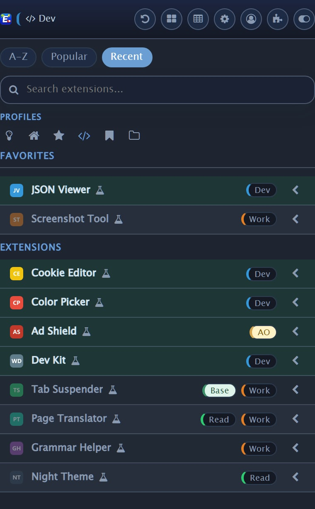
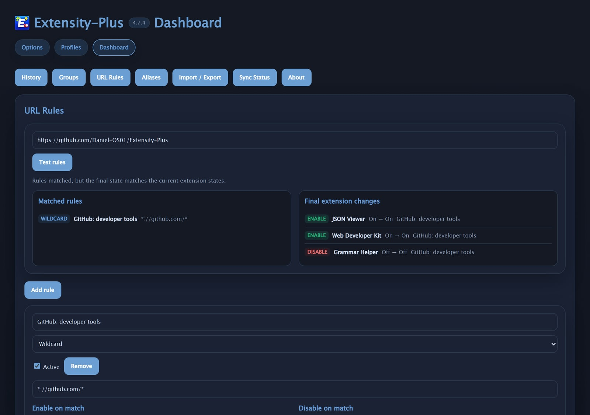
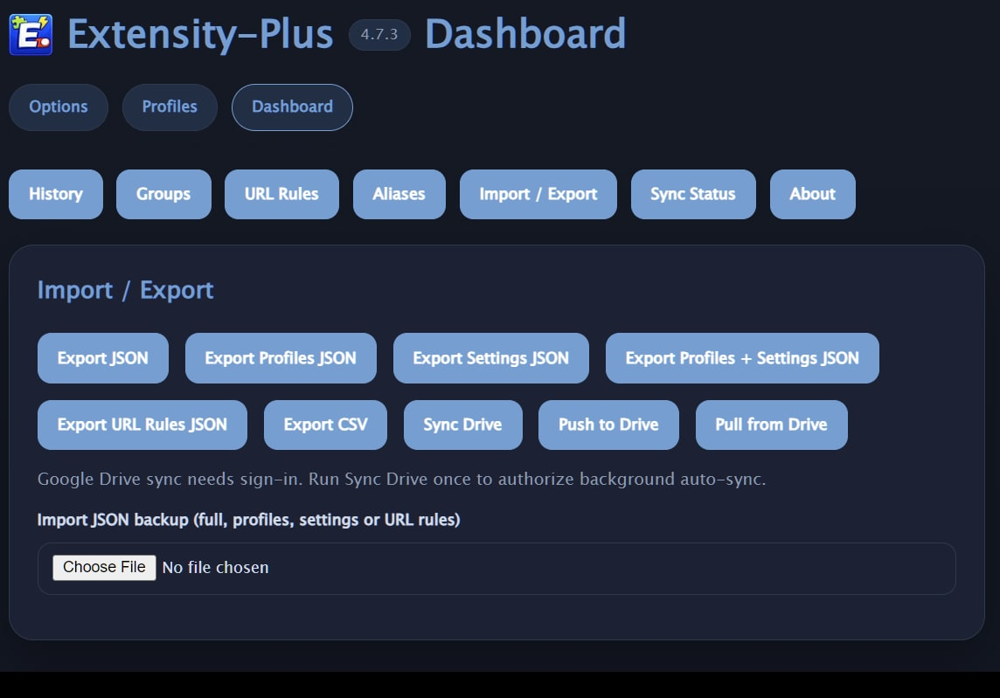

<h1 align="center">🧩 Extensity-Plus</h1>

<p align="center">
  
</p>

<p align="center">
  <b>One-click extension manager for Chrome &amp; Brave</b> with profiles, URL rules and sync.
</p>

<p align="center">
  <a href="https://github.com/Daniel-OS01/Extensity-Plus/releases"></a>
  <a href="https://chromewebstore.google.com/detail/extensity-plus/gbojjphhdboeaafjdilfibonoflhgcde"></a>
  
  
</p>

## ⚡ TL;DR

- 🔌 **Toggle any extension in one click.** Turn them all off and back on with one action, and undo your last change.
- 🗂️ **Profiles** switch between whole sets of extensions (for example *Work* or *Dev*). `Always On` extensions stay enabled.
- 🌐 **URL rules** turn extensions on or off automatically, depending on the site you're on.
- 🔄 **Sync** settings across devices with browser sync, or with optional Google Drive sync.
- 🚀 **Try it:** [install from the Chrome Web Store](https://chromewebstore.google.com/detail/extensity-plus/gbojjphhdboeaafjdilfibonoflhgcde). The listing works in Brave too.

## 🆕 Releases

**🔥 Latest: v4.7.4** (2026-11-21)
- ⚡ Faster popup search and bulk toggling. ♿ The profile delete button names its profile, and inputs that had only a placeholder now have labels.

**4️⃣ Version 4**
- ☁️ Google Drive sync, which got safer in 4.7: you confirm a preview before each sync, a safeguard pauses changes that would delete too much, and *Undo last sync* restores the last backup. 4.x also added the Full / Smart / Minimal browser-sync modes and the dashboard Log tab.

**3️⃣ Version 3**
- 📊 A Sync Status tab in the dashboard, export of only profiles or only settings, and a separate Favorites section in the popup.

**2️⃣ Version 2**
- 🏗️ The Extensity 2.0 rewrite: a Manifest V3 background worker, the dashboard (aliases, groups, URL rules, history), undo, grid view, sorting and pin-to-toolbar.

📜 Full notes: [GitHub Releases](https://github.com/Daniel-OS01/Extensity-Plus/releases)

## 📸 Screenshots

| Popup with profile badges | Row actions and profile menu |
|:---:|:---:|
|  |  |

| Profiles editor | Options |
|:---:|:---:|
|  |  |
| **URL rules with the live tester** | **Import / Export and Drive sync** |
|  |  |

## ✨ Features

**🔌 Popup**
- One-click toggle and *turn all off / restore*. Undo reverts the last toggle, bulk action or profile change.
- 🔎 Search by name, alias or description. Queries of 3+ characters also match typos.
- ↕️ Sort A–Z, by most recent use, or by how often you use each one. List or grid view.
- 📌 Pin to toolbar (automatic or manual, set in Options), and edit profile membership inline.

**🗂️ Profiles**
- Reusable extension sets with a color and icon each, plus the special `Always On`, `Base` and `Favorites` layers.
- Inline rename and bulk delete.
- ⌨️ `Ctrl+Shift+E` toggles everything. The next/previous-profile shortcuts have no default key; set them at `chrome://extensions/shortcuts`.

**🌐 URL rules**
- Enable or disable extensions when the tab URL matches a wildcard (`*://github.com/*`) or a regex.
- Test URLs against your rules in the dashboard first.

**🧰 Dashboard**
- 🏷️ Aliases and groups, history with usage counts, and a CSV export of your extensions.
- 💾 Full or scoped JSON backups. The scopes are profiles, settings, both, or URL rules, and the scope is detected on import.
- 🪵 Log tab (none / error / warn / info / debug) with an *Errors only* filter and copy to clipboard.
- 🔔 Optional reminders to turn an extension back off after you enable it manually.

## 🚀 Install

**From the store:** [Extensity-Plus on the Chrome Web Store](https://chromewebstore.google.com/detail/extensity-plus/gbojjphhdboeaafjdilfibonoflhgcde)

**From source** (for development):

1. Clone the repo. There is nothing to build.
2. Open `chrome://extensions` or `brave://extensions` and turn on **Developer mode**.
3. Click **Load unpacked** and pick the repo root, or `dist/` after `make dist` for the minified build.

## 🔄 Sync

**Browser sync** keeps settings and profiles in `chrome.storage.sync` (about 100 KB total, 8 KB per key). Options → **Browser Sync** has three modes:

| Mode | Syncs | Best for |
|------|-------|----------|
| 🟢 **Full** | All options + every profile's members | Small profile sets |
| 🟡 **Smart** (default) | All options + `Always On` / `Base` / `Favorites` + metadata | Most users |
| 🔵 **Minimal** | Options + profile metadata only | Lowest sync footprint |

**☁️ Google Drive sync (optional)** stores a versioned backup in your Drive's hidden app-data folder. It merges per item, shows you a preview to confirm before each sync, and pauses changes that would delete too much. It needs a **Chrome extension** OAuth client ID in `manifest.json`. Setup is in [`docs/google-drive-sync.md`](docs/google-drive-sync.md).

<details>
<summary>🩺 Sync health check and Brave notes</summary>

- Dashboard **Sync Status** and Options **Check sync status** confirm that your settings and profiles are in this browser profile's sync storage, and show byte usage and any fallback error.
- This check is not the browser's own sync diagnostics (`chrome://sync-internals`, `brave://sync-internals`). Those pages may not list extension data even when the check reports **Synced**.
- When profiles outgrow the quota, the extension falls back to **local-only profiles** (`localProfiles`) and the dashboard shows it.
- **Brave:** join the same Brave Sync chain on every desktop (`brave://settings/braveSync`), wait for the first merge, reload the extension on each device, then run the check. Brave has intermittent failures syncing *Extension settings* ([brave/brave-browser#46983](https://github.com/brave/brave-browser/issues/46983)). The extension cannot work around it.

</details>

## 🔐 Permissions

<details>
<summary>Why each permission is requested</summary>

| Permission | Why |
|------------|-----|
| `management` | List, enable and disable extensions (the core feature) |
| `storage` | Settings, profiles, rules, history and backups |
| `tabs`, `webNavigation` | Check URL rules against the active tab; open extension pages |
| `alarms`, `notifications` | Reminders and scheduled Drive sync |
| `identity` | Google sign-in for the optional Drive sync |
| `debugger` | Only for **automatic** pin-to-toolbar, which clicks Chrome's own pin control on `chrome://extensions`. It never attaches to websites |
| `https://www.googleapis.com/*` | Drive API, `drive.appdata` scope only |
| `https://chromewebstore.google.com/*` *(optional)* | Store metadata and links. You are asked before it is granted |

Full rationale: [`docs/chrome-web-store-privacy.md`](docs/chrome-web-store-privacy.md)

</details>

## 🛠️ Development

Needs Node.js 18+ (CI uses 22). `make dist` also needs `make` and `python3`; on Windows, run it from WSL.

```bash
npm install                  # dev tools: uglify-js, sass, sharp
npm test                     # unit tests (node --test)
npm run check:manifest       # validate manifest.json and tracked versions
make dist                    # build → dist/dist.zip
npm run bundle:chrome-store  # Chrome Web Store bundle (after make dist)
npm run generate:icons       # regenerate icons from the master PNG
```

<details>
<summary>🏗️ Architecture</summary>

- **One writer:** only `js/background.js` enables or disables extensions. The pages send it messages, so undo, usage counts, reminders and history always stay in step.
- **Split storage:** small settings and profiles go in `chrome.storage.sync`. Aliases, groups, rules, undo, history and counters go in `chrome.storage.local`.
- **No frontend build:** plain HTML pages with Knockout.js view models (`data-sbind` bindings). Each `js/` module is an IIFE that exposes a single namespace.

| Page | Script | Role |
|------|--------|------|
| `index.html` | `js/index.js` | Popup |
| `profiles.html` | `js/profiles.js` | Profile editor |
| `options.html` | `js/options.js` | Settings, sync, backups |
| `dashboard.html` | `js/dashboard.js` | Aliases, groups, rules, history, logs |

| Module | Job |
|--------|-----|
| `background.js` | Service worker, message API, all mutations, URL rule evaluation |
| `engine.js` | Shared view-model code, Knockout extenders, sync health check |
| `storage.js` / `migration.js` | Storage schema and defaults, versioned migrations |
| `url-rules.js` | Pattern matching and rule evaluation |
| `history-logger.js` / `logger.js` | Event history and the leveled session log |
| `reminders.js` | Reminder alarms |
| `import-export.js` | Versioned backup envelope |
| `drive-sync.js` / `drive-oauth-config.js` | Drive OAuth, merge and safeguards; web-OAuth fallback for Brave |

Message API and design notes: [`docs/extensity-2.0-plan.md`](docs/extensity-2.0-plan.md)

</details>

<details>
<summary>🤖 CI and releases</summary>

- [`ci.yml`](.github/workflows/ci.yml) runs tests, checks the manifest, and builds the extension and store bundle on every PR and every push to `main`.
- A manual run (`workflow_dispatch`) bumps the version, tags `vX.Y.Z`, publishes a GitHub release, and uploads a `release-assets-vX.Y.Z` artifact: the extension zip, the store zip, `submission-metadata.json`, `checksums.txt` and `submission-notes.md`.
- Pushing a `v*` tag runs [`release-chrome-web-store.yml`](.github/workflows/release-chrome-web-store.yml), which uploads a **draft** to the Chrome Web Store. Someone still publishes it by hand.
- Separate workflows run regression suites for URL rules, storage, migration, the message API, import/export and security.

Details: [`docs/ci-and-release.md`](docs/ci-and-release.md) · [`docs/release-automation.md`](docs/release-automation.md)

</details>

## 📚 Docs

| | |
|---|---|
| ☁️ [Google Drive sync](docs/google-drive-sync.md) | Setup, strategies, conflicts, recovery |
| 🤖 [CI and release](docs/ci-and-release.md) | Packaging and the pre-release test pass |
| 📦 [Release automation](docs/release-automation.md) | Chrome Web Store upload and credentials |
| ✅ [Store checklist](docs/chrome-web-store-checklist.md) | Submission checklist |
| 🔐 [Privacy and permissions](docs/chrome-web-store-privacy.md) | Permission justifications |
| 🧭 [2.0 plan](docs/extensity-2.0-plan.md) / [status](docs/extensity-2.0-status.md) | Architecture, message API, what shipped |
| 🛠️ [BUILD.md](BUILD.md) | Build details |

## 🔒 Security notes

- Drive sync needs a **Chrome extension** OAuth client. **Desktop app** credentials are only for store upload automation.
- 🚫 Never commit an OAuth `client_secret`.
- If you publish a fork to the Chrome Web Store, review its permissions, listing, privacy disclosures and OAuth setup first.

## 🙏 Credits

Built on the original [sergiokas/Extensity](https://github.com/sergiokas/Extensity) and developed separately from it. Ideas also came from [one-click-extensions-manager](https://github.com/hankxdev/one-click-extensions-manager), [auto-extension-manager](https://github.com/JasonGrass/auto-extension-manager) and [Extensity-Ultra](https://github.com/jeevan-lal/Extensity-Ultra).

📄 License: [`LICENSE.md`](LICENSE.md)
